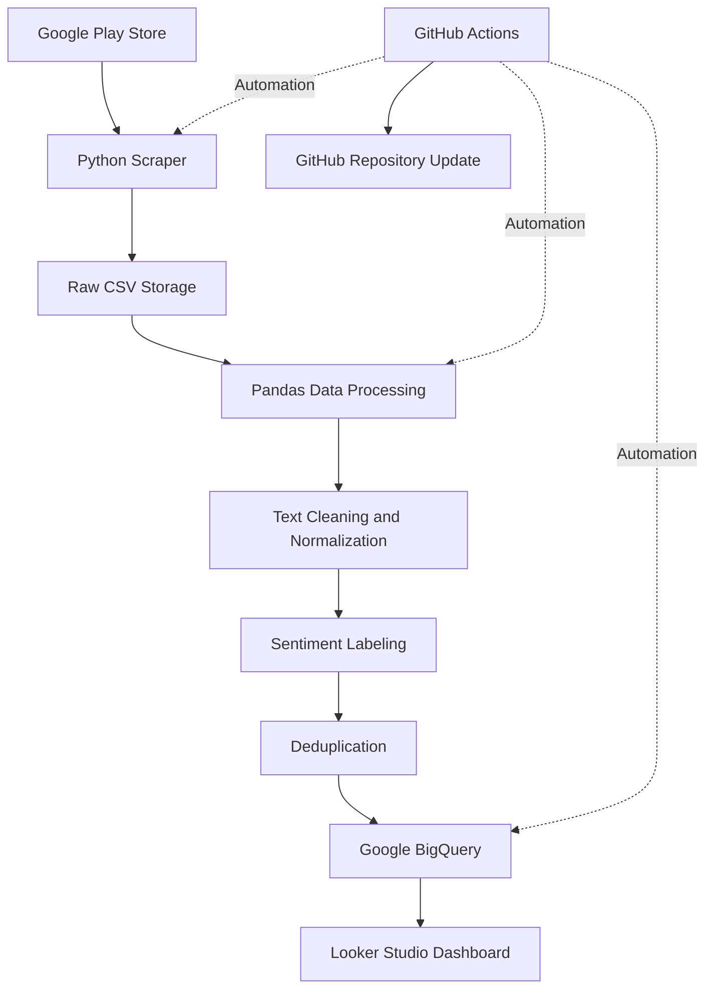

# Gojek vs Grab — Customer Review & Sentiment Analytics

An end-to-end Data Engineering project that collects, processes, stores, and analyzes customer reviews from Gojek and Grab on the Google Play Store.

This project aims to compare customer experiences, review trends, sentiment distribution, and customer service responsiveness between two major ride-hailing applications in Indonesia.

## Dashboard Preview

**Interactive Dashboard:** [View Gojek vs Grab Analytics](https://datastudio.google.com/reporting/bbe8253f-bec1-4966-a6cf-f9a37ab6e635)

The dashboard provides insights into:

- Total customer reviews
- Sentiment distribution (Positive, Neutral, Negative)
- Daily review trends: Gojek vs Grab
- Customer service response rate
- Most liked negative reviews

## Project Objectives

- Automate the collection of customer reviews from Google Play Store.
- Build an automated data pipeline for periodic data collection and processing.
- Clean and normalize Indonesian customer review text.
- Categorize reviews based on star ratings.
- Store structured review data in Google BigQuery.
- Build an interactive dashboard to compare customer feedback between Gojek and Grab.

## System Architecture



## Technology Stack

| Component | Technology |
|---|---|
| Programming Language | Python |
| Data Collection | google-play-scraper |
| Data Processing | Pandas |
| Data Storage | CSV |
| Data Warehouse | Google BigQuery |
| Workflow Automation | GitHub Actions |
| Data Visualization | Looker Studio |
| Version Control | Git & GitHub |

## Data Pipeline

### 1. Data Acquisition

Customer reviews are collected from the Google Play Store using the `google-play-scraper` Python library.

Target applications:

| Application | Package ID |
|---|---|
| Gojek | `com.gojek.app` |
| Grab | `com.grabtaxi.passenger` |

The scraper retrieves the latest reviews using the Indonesian language and Indonesia region settings.

Each scraping run targets up to 1,000 reviews per application.

### 2. Raw Data Storage

Collected reviews are stored in:

```text
data/gojek_grab_raw.csv
```

Historical records are combined with newly collected reviews to maintain a growing dataset.

Duplicate reviews are removed using review identifiers.

### 3. Data Cleaning & Transformation

Pandas is used to process the collected review data.

Main transformation steps:

- Convert review text to lowercase.
- Remove URLs and unnecessary special characters.
- Remove numeric characters.
- Normalize whitespace.
- Normalize common Indonesian abbreviations and informal words.
- Remove empty cleaned reviews.
- Assign sentiment labels based on star ratings.

Sentiment classification rules:

| Rating | Sentiment |
|---|---|
| 1–2 Stars | Negative |
| 3 Stars | Neutral |
| 4–5 Stars | Positive |

The processed dataset is saved as:

```text
gojek_grab_final.csv
```

**Note:** Sentiment labels in this project are derived from star ratings, not from a machine learning sentiment classifier.

### 4. Data Warehouse — Google BigQuery

Processed data is uploaded incrementally to Google BigQuery.

**Project:** `gojek-grab-analytics`

**Dataset:** `review_analytics`

**Table:** `fact_reviews`

The uploader checks existing review identifiers before inserting new records to prevent duplicate uploads.

Main fields include:

| Column | Description |
|---|---|
| `reviewId` | Unique review identifier |
| `userName` | Reviewer name |
| `content` | Original review text |
| `score` | Star rating |
| `thumbsUpCount` | Number of helpful votes |
| `at` | Review creation timestamp |
| `replyContent` | Developer response |
| `repliedAt` | Developer response timestamp |
| `app_name` | Gojek or Grab |
| `cleaned_content` | Processed review text |
| `sentiment` | Sentiment category |

### 5. Workflow Automation — GitHub Actions

The data pipeline is automated using GitHub Actions.

The workflow is configured to run:

- Automatically on the first day of every month at 08:00 WIB.
- Manually through GitHub Actions using `workflow_dispatch`.

Automated workflow:

1. Checkout the GitHub repository.
2. Set up Python 3.11.
3. Install project dependencies.
4. Execute the scraper.
5. Authenticate with Google Cloud.
6. Upload new reviews to BigQuery.
7. Commit and push updated CSV files to GitHub.

Google Cloud authentication is handled through GitHub Repository Secrets using `GCP_SERVICE_ACCOUNT_KEY`.

No service account credentials are stored in the repository.

## Dashboard & Analysis

The Looker Studio dashboard provides a comparative analysis of Gojek and Grab.

**Dashboard:** [Open Interactive Dashboard](https://datastudio.google.com/reporting/bbe8253f-bec1-4966-a6cf-f9a37ab6e635)

Key analysis areas:

- **Review Volume:** Compare the total number of reviews for each application.
- **Sentiment Distribution:** Understand the proportion of positive, neutral, and negative feedback.
- **Review Trends:** Observe changes in review volume over time.
- **Customer Service Response:** Compare how frequently each application responds to customer reviews.
- **Most Liked Negative Reviews:** Identify highly appreciated negative feedback to understand recurring customer complaints.

## Initial Findings

Based on the collected dataset snapshot after the latest successful automated run:

| Metric | Gojek | Grab |
|---|---:|---:|
| Total Reviews | 4,856 | 4,198 |
| Developer Replies | 2,511 | 1,734 |
| Negative Reviews | 2,408 | 1,008 |
| Response Rate | 51.69% | 41.31% |

### Key Observations

- Gojek has a higher review volume in the collected dataset.
- Gojek has a higher proportion of negative reviews.
- Gojek also has a higher developer response rate than Grab.
- Highly liked negative reviews reveal customer concerns involving driver services, application stability, payment issues, promotions, and customer support.

*These findings represent the collected dataset snapshot and may change as new reviews are ingested.*

## Project Structure

```text
gojek-grab-scraper/
│
├── .github/
│   └── workflows/
│       └── scrape.yml
│
├── data/
│   └── gojek_grab_raw.csv
│
├── scraper.py
├── upload_to_bigquery.py
├── gojek_grab_final.csv
├── requirements.txt
├── .gitignore
└── README.md
```

## Local Setup

### Prerequisites

- Python 3.11 or later
- Google Cloud project
- BigQuery dataset and table
- Google Cloud service account with appropriate BigQuery permissions

### 1. Clone the Repository

```bash
git clone https://github.com/silitnop/gojek-grab-scraper.git
cd gojek-grab-scraper
```

### 2. Create a Virtual Environment

```bash
python -m venv .venv
```

Activate the environment:

Windows:

```bash
.venv\Scripts\activate
```

Linux/macOS:

```bash
source .venv/bin/activate
```

### 3. Install Dependencies

```bash
pip install -r requirements.txt
```

### 4. Configure Google Cloud Authentication

Set the environment variable to your service account JSON key:

Windows PowerShell:

```powershell
$env:GOOGLE_APPLICATION_CREDENTIALS="path/to/service-account.json"
```

Never commit the service account JSON key to GitHub.

### 5. Run the Scraper

```bash
python scraper.py
```

### 6. Upload New Reviews to BigQuery

```bash
python upload_to_bigquery.py
```

## Requirements

Dependencies are listed in `requirements.txt`:

```text
google-play-scraper
pandas
google-cloud-bigquery
pyarrow
```

## Future Improvements

- Implement more advanced Indonesian sentiment analysis using NLP.
- Add data quality validation and automated pipeline monitoring.
- Improve incremental ingestion for larger review datasets.
- Introduce an orchestration platform such as Apache Airflow.
- Expand the analysis with topic modeling and customer complaint categorization.
- Add automated testing for data transformations and pipeline reliability.

## Author

**Sultan Naufal**

GitHub: [@silitnop](https://github.com/silitnop)

---

*This project was developed as part of a personal Data Engineering portfolio to demonstrate data acquisition, transformation, warehouse integration, workflow automation, and analytical visualization.*